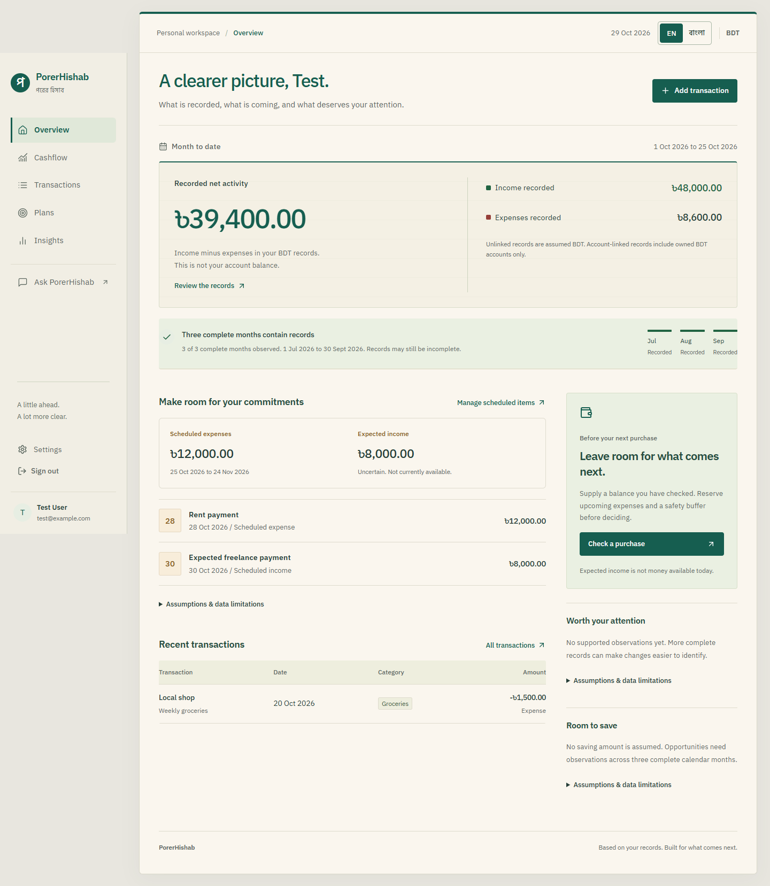
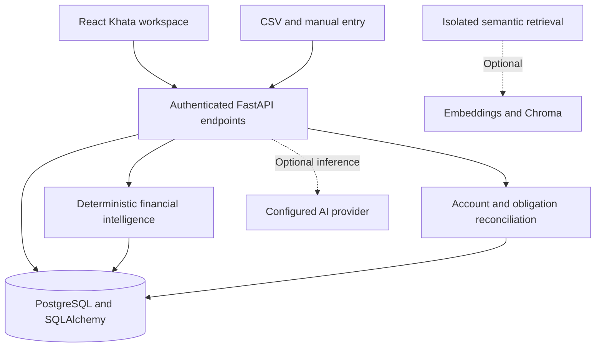

# পরের হিসাব — PorerHishab

**আজকের খরচ, আগামীর পরিকল্পনা।**


PorerHishab is a Bangladesh-first personal finance project built around one question: **What can I spend after accounting for what comes next?** It combines transaction tracking, deterministic financial intelligence, savings planning, and obligation reconciliation in an English/Bengali web workspace.

This README covers the work completed so far, partial capabilities and remaining integration, and future implementations. The project has progressed from database-backed CSV analytics to a full-stack finance coach; it is not yet a deployed banking integration or production financial service.

## Project status

Status as of **30 October 2026**:

| Area | Status | Delivered capability |
| --- | --- | --- |
| Backend and persistence | Implemented | FastAPI, PostgreSQL, SQLAlchemy, Alembic, authentication and user-scoped queries |
| Transactions and categorization | Implemented | CSV/manual entry, search/filters, corrections, merchant preferences, rules and optional validated AI fallback |
| Analytics and financial planning | Implemented | Spending analysis, average-based forecasts, purchase assessments, savings goals and contribution plans |
| AI evaluation | Implemented | Offline finance, categorization, recommendation and insight evaluation with a combined quality gate |
| Financial Intelligence Engine | Implemented | Shared deterministic facts, periods, coverage, snapshots, goal assessments and signals |
| Khata frontend | Implemented | Responsive React workspace, English/Bengali interface, API/auth integration and generated contracts |
| Account balance reconciliation (AI-15A) | Implemented and merged | Reported/opening balances, derived evidence, differences, status and confidence |
| Obligation reconciliation (AI-15B) | Implemented and merged | Reviewed candidates, confirmed allocations, partial payments and revocation history |
| Financial alerts and coaching (AI-15F) | Implemented; pending PR review | Deterministic prioritized cash, obligation, spending and goal reviews with bilingual evidence; [implementation notes](docs/ai-15f-financial-alerts-and-coaching.md) |
| Bangla/Roman Bangla coaching | Partial / future work | Bengali interface and some categorization rules exist; Ask currently uses supported English questions |
| Financial integrations and delivery | Planned | SMS/PDF/email ingestion, bank/MFS synchronization, WhatsApp/Messenger and notifications |
| Production rollout | Pending | Hosting, operational controls, security hardening and production data validation |

AI-15B was merged through [PR #37](https://github.com/mutassimalzeem/PorerHishab/pull/37). Implemented does not mean deployed. Future roadmap items have no committed delivery dates.

## Implemented features

### Authentication and user ownership

- Registration, sign-in, JWT access/refresh tokens, password hashing and login rate limiting.
- Shared authentication dependencies, owner-scoped finance queries and cross-user regression tests.
- Protected frontend routes, preserved deep links, session-expiry recovery and stale-request protection.
- Tokens held in frontend memory; a full page reload requires signing in again.

### Transaction ingestion and management

- CSV upload, manual entry, search, date/category/amount filters, sorting and pagination.
- Signed amounts: positive income and negative expense.
- Account-linked transactions with external ID, date, description, merchant, category/subcategory, fees, balance, source, recurring flag and raw metadata.
- User/external-ID uniqueness constraints and ownership checks for linked accounts.
- Transaction details drawer, import feedback and category corrections in the frontend.

CSV ingestion is implemented; provider-specific statement parsing and automatic synchronization are future work. A stored source/recurring flag is not a live account connection or recurring bill schedule.

### Categorization and feedback

- Merchant normalization, configurable taxonomy and deterministic keyword rules, including supported Bangladesh-oriented vocabulary.
- Per-user merchant preferences learned from explicit category corrections.
- Optional validated LLM fallback when external inference is explicitly enabled; unavailable/invalid results fall back safely.
- Persisted category method, confidence, reason and correction history; user-confirmed values take precedence.
- Authenticated categorization workflow and offline categorization evaluation.

### Analytics and spending intelligence

- Income, expenses, net cashflow, savings rate and monthly history.
- Month-over-month comparisons, date-scoped summaries, category/merchant breakdowns and budget baselines.
- Recurring-pattern observations, qualified savings opportunities and evidence-backed financial signals.
- Coverage statements and insufficient-data states rather than invented financial certainty.

Recorded net activity is distinct from an available account balance. Recurring-pattern observations are historical evidence, not verified subscriptions.

### Forecasting and spending decisions

- Historical cashflow forecasting from a caller-supplied starting balance, with monthly projections and coverage.
- Budget/category forecasts based on historical and recent spending.
- Basic purchase assessment against explicitly supplied balance and safety buffer.
- Separate coach scenarios that reserve known scheduled expenses and display uncertain scheduled income separately.
- Obligation-aware purchase assessment over a selected horizon.
- Accessible charts/data tables with assumptions and unavailable-estimate states.

Current forecasts use simple averages, not seasonal Prophet/ARIMA models. A projection is a scenario rather than a bank-verified safe-to-spend amount.

### Savings planning and coaching

- Stateless savings plans and optional AI savings actions.
- Persistent goals with target amount/date, nullable self-reported savings and lifecycle status.
- Frontend goal creation/editing, progress, and required weekly/monthly contributions.
- Deterministic capacity/affordability assessments using recorded history and commitments.
- Personalized spending-reduction recommendations with labeled monthly/annual estimates.
- Insufficient-data behavior instead of fabricated savings or inferred goal balances.

### Scheduled income and expenses

- Dated plans with original amount, category, notes and scheduled/paid/cancelled status.
- Authenticated CRUD, filters, pagination and frontend editing/status actions.
- Overdue obligations distinguished from future commitments.
- Plans kept separate from actual transactions: saving a schedule does not move money.

### Finance Q&A, proactive insights and optional AI

- Supported English finance questions routed to deterministic, user-scoped SQL facts with explicit periods and coverage.
- Structured answers containing calculations, sources, status and limitations.
- Spending, savings, upcoming-obligation and purchase-context workflows.
- Deterministic proactive insights with stable keys, evidence periods, severity and expiry.
- Optional provider-backed categorization and wording with bounded settings and safe fallbacks.
- Isolated semantic retrieval modules for transaction documents, embeddings, Chroma and RAG context/retrieval.

Core coach/intelligence calculations require no LLM or vector database. Semantic retrieval is not authoritative financial arithmetic. External inference is disabled by default; enabling it can disclose transaction description text to the configured provider.

### Financial Intelligence Engine (AI-13)

The reusable engine provides Dhaka-calendar periods, user-scoped aggregates, BDT-account-aware facts, snapshots, coverage, category comparisons, scheduled obligations, goal assessments and signals. It separates **observed**, **scheduled**, **estimated** and **interpreted** information so consumers share calculations rather than inventing financial facts.

See [Financial Intelligence Engine](docs/financial-intelligence-engine.md) for architecture and calculation rules.

### Account balance reconciliation (AI-15A)

- APIs for reported balance, balance source/as-of metadata, opening balance and opening date.
- Transaction-derived reconciliation, including separately recorded fees.
- Balance differences, status, confidence and explanations.
- Explicit distinction between reported-only, derived, reconciled and mismatched evidence.

These APIs do not connect to banks/MFS providers. The current Cashflow screen still requests an explicitly supplied starting balance; reconciliation is not yet a complete account-management frontend.

### Transaction-to-obligation reconciliation (AI-15B)

- Explainable exact, partial and ambiguous transaction candidates, with amount/date/category/text signals.
- Configurable suggestion tolerances: default inclusive seven-day date window and BDT 0.00 absolute amount tolerance.
- Owner/direction checks, owned BDT-account eligibility and unlinked imports assumed BDT.
- Multiple transactions per obligation, with only one active allocation per transaction.
- Original scheduled amount preserved alongside allocated principal, remaining amount and retained revocation history.
- PostgreSQL ownership constraints, unique active-allocation index and serialized mutations preventing concurrent over-allocation.
- Explicit full-settlement confirmation, remove-allocation actions and protected reconciliation history.
- Future obligation reserves reduced by confirmed payments so paid principal is not reserved again.
- English/Bengali candidate review, progress and unmatched/overdue/not-due/insufficient-data states.

Suggestions never allocate money or mark items paid automatically. Separate fees do not settle principal. Over-allocation, FX conversion and splitting a transaction across obligations are unsupported. Existing manually marked paid items remain valid without claiming transaction verification.

See the [AI-15B report](docs/ai-15b-obligation-reconciliation.md) for matching, APIs, concurrency guarantees and migrations.

## Frontend: the Khata workspace

The React + TypeScript application uses a paper-and-teal ledger design, localized numbers/dates and responsive desktop/mobile navigation.

| Screen | Implemented workflows |
| --- | --- |
| Overview | Recorded activity, coverage, upcoming commitments, recent transactions, signals and savings links |
| Transactions | Search/filter, pagination, manual entry, CSV upload, details and category correction |
| Cashflow | Schedules, reconciliation candidates/allocations, remaining principal, forecasts and purchase assessments |
| Plans | Savings targets, reported progress, goal editing and contribution needs |
| Insights | Observations, evidence, category comparisons, recurring patterns and recommendations |
| Ask | Starter questions, supported English prompts, optional financial context and grounded answers |
| Settings | Identity, language, session/privacy explanation and sign out |
| Authentication | Registration/login, preserved deep links, validation and session recovery |

The UI has loading/error/retry states, actionable empty states, unknown values distinct from zero, keyboard navigation, dialogs, focus restoration and reduced-motion support. Language switching preserves drafts and canonical API values. User content/backend prose retain their original language; Bengali UI does not imply Bengali conversational understanding.



See [frontend setup](frontend/README.md), [Khata redesign/localization](docs/frontend-khata-redesign.md) and [frontend refinement](docs/frontend-refinement.md).

## Work in progress and remaining integration

These areas have partial foundations but are not complete product capabilities. This table describes remaining work, not a claim that every item has an active coding branch.

| Area | Existing foundation | Remaining work |
| --- | --- | --- |
| Trusted financial position | Account evidence/reconciliation APIs | Account-management UI, freshness handling and verified-balance integration into scenarios |
| Bangla-first coaching | Bilingual UI and supported categorization terms | Bangla/Roman Bangla intents, localized explanations and language evaluation |
| Obligation lifecycle | Dated schedules and reviewed allocations | Recurrence/instances, rescheduling and broader bill/income workflows |
| Proactive delivery | Stable signal IDs and expiry | Persisted lifecycle, preferences, delivery and cross-session dismissal |
| Semantic assistance | Isolated retrieval/embedding modules | Further retrieval evaluation and bounded integration with deterministic facts |
| Production readiness | Docker DB, migrations and automated checks | Hosting, backups/restore, managed secrets, CORS hardening, monitoring and account recovery |

## Future implementations and roadmap

These are proposed directions, not shipped features, verified accuracy targets, pricing commitments or dated delivery promises. [FEATURES.md](FEATURES.md) contains the broader historical feature vault; its old technical audit is not current implementation status.

| Direction | Proposed capabilities |
| --- | --- |
| Bangladesh ingestion | bKash/Nagad/Rocket/Upay SMS parsing, bank PDF/OCR, email forwarding, Excel import and header mapping |
| Connected accounts | Consented bank/MFS synchronization, duplicate handling and account-specific views |
| Better forecasting | Improved coverage, seasonal/income-cycle models, Ramadan/Eid/bonus scenarios and finer depletion estimates |
| Fees/subscriptions | Fee breakdowns, recurring-charge review, renewal/trial reminders and saving opportunities |
| Conversational channels | WhatsApp/Messenger, Bangla/Roman Bangla understanding, voice input and scheduled briefings |
| Shared finance | Family/couple/mess khata, permissions, shared budgets and collective goals |
| Local savings tools | DPS/FDR/Sanchayapatra maturity tracking, remittance and locally relevant savings workflows |
| Tax/social finance | Carefully validated tax guidance, Zakat calculations and seasonal planning |
| Behavior support | Optional reminders, spending cooldowns, salary-cycle planning and fuller safe-to-spend explanations |
| Privacy/security | Consent controls, export/deletion, encryption/local-processing options, OAuth/2FA and auditability |
| Delivery/commercialization | Hosted service, mobile/PWA exploration, subscriptions/billing and payment-provider evaluation |

## Milestones completed so far

| Milestone | Delivered work |
| --- | --- |
| Database / DB-08 to DB-10 | PostgreSQL, migrations, transaction repository integration and user isolation |
| FIN-01 and planning foundation | Analytics, transaction intelligence, budget forecasts and savings plans |
| AI-06 / AI-07 categorization work | Rules, validated fallback, metadata, corrections and merchant preferences |
| AI-08 | Spending intelligence, grounded insights and savings coaching |
| AI-09 | Cashflow forecast v1 |
| AI-10 | Explicit-balance spending assessment |
| AI-11 and complete coach | Scheduled cashflow, persistent goals, date-aware Q&A, recommendations and obligation scenarios |
| AI-12A through AI-12E | Offline finance/grounding, categorization, recommendation/insight evaluation and quality gate |
| AI-13 | Shared Financial Intelligence Engine |
| Frontend and Khata redesign | Finance workspace, UX refinements, responsive behavior and English/Bengali localization |
| AI-14 integration | Auth/CSV contracts, generated API types, frontend/backend integration and regression fixes |
| AI-15A | Account balance reconciliation; merged in PR #36 |
| AI-15B | Transaction-to-obligation reconciliation; merged in PR #37 |

Milestone reports describe their implementation-time state. Current code and OpenAPI take precedence over historical descriptions of interfaces that were later extended.

## Architecture and technology



| Layer | Technology and role |
| --- | --- |
| Frontend | React, TypeScript, Vite, React Router, Lucide icons and CSS |
| API | FastAPI, Pydantic contracts and JWT authentication |
| Persistence | PostgreSQL 16 in Compose, SQLAlchemy and Alembic |
| Financial logic | Deterministic Python services; Decimal/Numeric in reconciliation and core planning/forecasts |
| Analytics | SQL aggregates and pandas in existing ingestion/analytics paths |
| Optional AI/retrieval | Configurable OpenAI-compatible provider, LangChain integrations, embeddings and Chroma |
| Verification | pytest, offline evaluations, Vitest, Testing Library, ESLint, TypeScript and Playwright |
| Automation | GitHub Actions for frontend, API contracts, selected intelligence regressions and browsers |

```text
PorerHishab/
|-- backend/
|   |-- app/
|   |   |-- main.py              # API entry point and legacy routes
|   |   |-- api/                 # Authenticated finance endpoints
|   |   |-- core/                # Settings, security and database
|   |   |-- models/              # Users, accounts, transactions, goals and allocations
|   |   |-- schemas/             # Request/response contracts
|   |   |-- repositories/        # User-scoped persistence and queries
|   |   |-- services/            # Analytics, intelligence, coaching and reconciliation
|   |   `-- evaluation/          # Offline datasets, runners and quality gate
|   |-- test_*.py
|   |-- requirements*.txt
|   `-- Dockerfile
|-- frontend/
|   |-- src/                    # Pages, components, locale and generated API types
|   `-- e2e/                    # Desktop/mobile browser tests
|-- alembic/versions/            # Database migration history
|-- docs/                       # Reports, setup and screenshots
|-- scripts/                    # API contracts and startup check
|-- .github/workflows/
|-- docker-compose.yml
|-- pyproject.toml
`-- .env.example
```

The backend import package is `app`; the distribution is `porer-hishab-backend`. `architecture.md` is a historical target layout rather than an exact source tree.

## API overview

The entry point is `backend/app/main.py` (`app.main:app`). The running server's `/docs` describes all request parameters and response schemas. Finance resources require authentication and ownership checks.

| Method | Endpoint | Purpose |
| --- | --- | --- |
| POST | `/register`, `/login`, `/refresh` | Registration and tokens |
| GET | `/me` | Current identity |
| POST | `/upload-csv` | CSV ingestion |
| GET, POST | `/transactions` | Search/list or create transactions |
| GET | `/transactions/me` | Legacy user transaction list |
| PATCH | `/transactions/{transaction_id}/category` | Category correction and preference history |
| POST | `/transactions/categorize` | Categorization workflow |
| GET | `/search`, `/summary`, `/categories/summary` | Legacy search/summaries |
| GET | `/insights/overview`, `/insights/summary`, `/insights/monthly`, `/insights/month-over-month` | Historical summaries |
| GET | `/insights/categories`, `/insights/merchants`, `/insights/recurring` | Spending analysis |
| GET | `/insights/cashflow`, `/insights/budget-baseline` | Cashflow history and baseline |
| GET | `/insights/ai`, `/insights/proactive` | AI presentation and deterministic insights |
| GET | `/finance/intelligence` | Shared financial intelligence |
| GET | `/forecast/budget`, `/forecast/cashflow` | Historical-average forecasts |
| POST | `/planner/savings`, `/planner/savings/coach` | Savings planning and optional guidance |
| POST | `/finance/spending-decision` | Basic purchase assessment from supplied values |
| POST | `/finance/coach/cashflow`, `/finance/coach/spending-decision` | Obligation-aware scenarios |
| GET, POST | `/finance/goals` | List or create savings goals |
| GET, PATCH, DELETE | `/finance/goals/{goal_id}` | Read, edit or delete a goal |
| GET | `/finance/goals/{goal_id}/plan` | Contribution and affordability plan |
| GET | `/finance/savings/recommendations` | Evidence-backed savings opportunities |
| POST | `/chat/ask` | Grounded finance questions |
| GET, POST | `/finance/scheduled-cashflow` | List or create schedules |
| GET, PATCH, DELETE | `/finance/scheduled-cashflow/{item_id}` | Manage schedules; reconciliation history is protected |
| GET | `/finance/scheduled-cashflow/reconciliation` | Paged reconciliation overview |
| GET | `/finance/scheduled-cashflow/{item_id}/matches` | Candidate evidence and allocation history |
| POST | `/finance/scheduled-cashflow/{item_id}/matches/{transaction_id}/confirm` | Explicit allocation and optional full settlement |
| DELETE | `/finance/scheduled-cashflow/{item_id}/matches/{transaction_id}` | Revoke allocation and retain history |
| GET | `/accounts/{account_id}/balance/reconciliation` | Balance evidence and differences |
| PATCH | `/accounts/{account_id}/balance`, `/accounts/{account_id}/balance/opening` | Report current/opening balance evidence |

## Local development

Use the repository root as the backend working directory. Python 3.12 and Node 24 were used for recent validation; see [frontend requirements](frontend/README.md) for Node setup. Database-backed integration tests require PostgreSQL.

### Backend and database

```bash
git clone https://github.com/mutassimalzeem/PorerHishab.git
cd PorerHishab
python -m venv .venv
```

Activate in PowerShell:

```powershell
.\.venv\Scripts\Activate.ps1
```

Or on macOS/Linux:

```bash
source .venv/bin/activate
```

Install core dependencies and the editable backend:

```bash
python -m pip install -r backend/requirements.txt
python -m pip install -e .
```

Copy `.env.example` to `.env` and configure database/authentication values. Settings resolve `.env` from the repository root. Do not commit credentials; Compose values are local development defaults.

```bash
docker compose up -d
alembic upgrade head
alembic current
uvicorn app.main:app --reload
```

API: `http://127.0.0.1:8000`. Interactive documentation: `http://127.0.0.1:8000/docs`. `python scripts/check_uvicorn.py` provides a startup smoke check.

### Frontend

In another terminal:

```bash
cd frontend
npm ci
npm run dev
```

Open `http://127.0.0.1:5173`. The development proxy forwards `/api` to the backend. Register/sign in and add/import your own records; the application has no seeded production demo account. See [frontend setup](frontend/README.md) for proxy settings, authentication behavior and Windows streamed-drive troubleshooting.

### Optional inference and retrieval

Core coach/intelligence endpoints work without external AI. Install optional packages for the corresponding workflows:

```bash
python -m pip install -r backend/requirements-ai.txt
python -m pip install -r backend/requirements-rag.txt
```

Settings in `.env.example` include `AI_EXTERNAL_ENABLED` (default `false`), `OPENAI_KEY`, `OPENAI_BASE_URL`, `OPENAI_CHAT_MODEL`, timeout/output limits, embedding settings and optional category taxonomy/rules. Provider/model choices are configuration, not requirements for deterministic calculations. Historical RAG test collection may require optional RAG packages even without live inference.

### CSV format

The upload route requires `amount` and accepts optional transaction fields. Use dates and signed amounts for meaningful analytics:

```csv
date,description,merchant,amount,category
2026-10-01,Monthly salary,Employer,50000.00,Income
2026-10-02,Groceries,Local shop,-1500.00,Groceries
```

These are format examples, not seeded data. Review imported signs, dates, duplicates and coverage before relying on a financial view.

## Database and migration compatibility

- Models/migrations cover users, accounts, transactions, corrections/preferences, savings goals, schedules and allocations.
- AI-15A migration `8d51117bc8d5` adds account balance evidence metadata.
- AI-15B migration `f15b00000001` follows it and adds allocation history, ownership constraints and indexes.
- Apply `alembic upgrade head` before serving allocation-aware queries or running integration tests. Migration roundtrips are tested in isolated PostgreSQL schemas.
- AI-15B downgrade drops allocation history/helper constraints while preserving schedules and transactions; it is a rollback, not an audit export.

The project was renamed from Zyra. PostgreSQL database/role `zyra`, Compose container `zyra-db`, volume key `zyra_postgres_data` and Chroma collection default `zyra_transactions` remain for compatibility. Preserve the Compose project identity when using existing volumes: directory/project renames can select a different volume. Historical branches/reports retain their original names.

## Testing, evaluations and CI

From the repository root with the environment activated and PostgreSQL migrated:

```bash
python -m pytest backend -q -rs
python -m pytest backend/test_account_reconciliation.py backend/test_obligation_reconciliation.py -q
python -m compileall -q backend/app
python scripts/generate_frontend_contracts.py --check
python backend/app/evaluation/quality_gate.py
git diff --check
```

Regenerate frontend contracts after schema changes with `python scripts/generate_frontend_contracts.py`.

From `frontend/`:

```bash
npm run typecheck
npm run lint
npm test
npm run build
npm run test:browser
```

Playwright needs an installed supported browser. Recent local verification used Chrome via `$env:PLAYWRIGHT_CHANNEL='chrome'` in PowerShell; CI installs Chromium.

| Verification area | Coverage |
| --- | --- |
| Backend pytest | Services, schemas, repositories, auth/APIs, arithmetic, user isolation and database integration |
| Reconciliation | Duplicates, partial/full settlement, revocation, currency/direction, tolerance boundaries and concurrent confirmations |
| Offline AI evaluation | Grounded finance, dates/numbers, categorization quality, correction preservation, recommendations and insights |
| Combined quality gate | Deterministic PASS/FAIL/ERROR reports and JSON aggregation of existing evaluation suites |
| Frontend unit tests | API/auth behavior, localization, financial states and reconciliation interactions |
| Browser tests | Desktop/mobile workflows, keyboard/dialog behavior, accessibility, overflow and English/Bengali layouts |
| GitHub Actions | Contract freshness, selected intelligence tests, frontend checks/build and browser checks on configured push/PR events |

**Latest recorded full-stack validation (AI-15B):** 418 backend tests passed, 1 opt-in live embedding test skipped; 41 frontend tests passed; 21 browser tests passed, 5 duplicate mobile viewport-matrix entries skipped. A final targeted reconciliation rerun passed on desktop and mobile. Compile, contract freshness, migration roundtrip, frontend typecheck/lint/build and whitespace checks passed. These are recorded milestone results, not a fresh application test run for each documentation change.

Live embedding smoke requires `RUN_LIVE_AI_TESTS=1`. The deterministic quality gate uses controlled synthetic scenarios and no external AI provider. It measures contract/grounding consistency, not real-world financial-advice quality. See [AI quality gate](docs/ai-quality-gate.md).

## Current limitations and production boundaries

- Imports may be incomplete. Recorded totals and reconciliation evidence do not prove a complete bank/MFS position.
- Forecasts use averages and supplied balances. The legacy cashflow forecast zero-fills missing calendar months; coverage-aware coach estimates require sufficient complete-month history. Their coverage contracts are not identical.
- Reconciliation and core planning/forecasts use Decimal/Numeric; some legacy upload/summary analytics retain pandas/float representations.
- Shared finance facts use owned BDT accounts and assume unlinked imports are BDT. No FX conversion or account-specific forecast product is implemented.
- Reconciliation checks recorded evidence, not a live provider statement. Obligation candidates need review, and history-backed terms/deletions are protected.
- Savings balances are self-reported. Scheduled income is uncertain; a plan is not an actual transaction.
- Monthly projections do not predict an exact depletion date or prove a purchase is safe. Omitted bills, fees, irregular income and unrecorded activity change outcomes.
- Bengali presentation is implemented; Ask and backend explanations are not a complete multilingual conversation system.
- Insight hiding is visit-scoped; notification delivery and persisted dismissal are not implemented.
- No bank/MFS sync, mobile SMS access, PDF/OCR ingestion, production billing, household accounts or WhatsApp/Messenger bot is shipped.
- Production work remains: restrictive CORS, managed secrets, recovery/session controls, monitoring, backups, retention/deletion policies and provider-consent review.

## Documentation map

| Document | Purpose |
| --- | --- |
| [Feature vault](FEATURES.md) | Long-term proposals; historical market/pricing assumptions are not shipped commitments |
| [Database foundation](docs/db-batch-db08-db10-status.md) | Historical DB-08 to DB-10 and FIN-01 report |
| [AI coach APIs/setup](docs/ai-coach.md) | Coach endpoints, configuration, assumptions and examples |
| [Coach implementation map](docs/ai-coach-implementation-map.md) | Historical integration decisions |
| [Recommendation/insight evaluation](docs/ai-12d-recommendation-insight-evaluation.md) | Structured offline evaluation |
| [AI quality gate](docs/ai-quality-gate.md) | Evaluators, thresholds, reports and commands |
| [Financial Intelligence Engine](docs/financial-intelligence-engine.md) | Shared facts, snapshots, coverage, periods and signals |
| [Frontend implementation](docs/frontend-implementation.md) | Original workflow/component inventory |
| [Frontend refinement](docs/frontend-refinement.md) | UX/API integration audit |
| [Khata redesign](docs/frontend-khata-redesign.md) | Visual design, localization and responsive verification |
| [Frontend setup](frontend/README.md) | Run/build/test instructions and platform notes |
| [AI-15B reconciliation](docs/ai-15b-obligation-reconciliation.md) | Persistence, matching, APIs, migration, tests and tradeoffs |

## Author

**Shahriar Zeem** — Backend Developer | ML Enthusiast

- [GitHub](https://github.com/mutassimalzeem)
- [Portfolio](https://mutassimalzeem.vercel.app/)
- [LinkedIn](https://www.linkedin.com/in/mutassimalzeem/)
