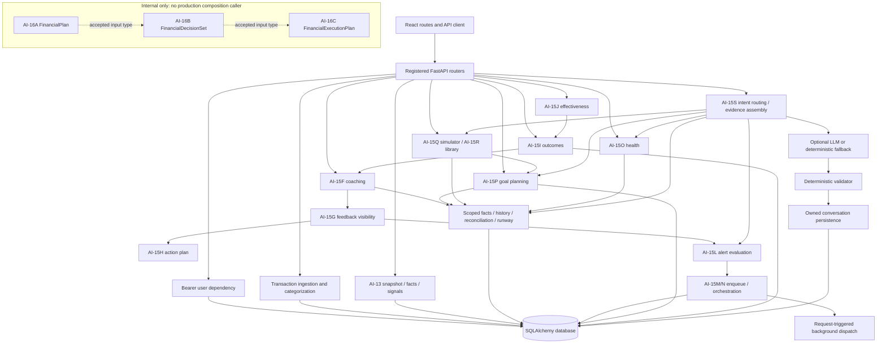

# AI-17 Architecture Integration Audit

Audit date: 2026-11-02 (Asia/Dhaka). Source baseline: `6807e53c0f9fc4e376ca60fa023adfd905256505`, merge of PR #61; inspected on `main`, with `HEAD == origin/main` after fetch.

The user's explicit PR request overrides the attached brief's prohibition on branches and PRs for delivery of this report only. This is a documentation-only audit. Implementation recommendations below require a separate task; no source, tests, dependencies, migrations, generated contracts or workflows are changed.

## 1. Executive Summary

PorerHishab has a substantial deterministic finance backend and usable React workflows for transactions, reconciled accounts, runway, goals, scenarios, alerts and coaching feedback. The older recommendation-to-feedback-to-observed-outcome loop is connected. AI-16A/B/C are tested internal capabilities, not an integrated product workflow.

Contracts can be composed in tests, but production code does not invoke that composition. `build_financial_plan`, `prioritize_financial_plan` and `build_financial_execution_plan` have no callers outside their implementation modules and tests. No registered endpoint, generated frontend contract or UI consumer exposes their outputs. AI-15S uses separate intent-specific evidence and does not consume this chain.

Two financial-correctness issues should precede expanded integration: CSV upload preprocessing changes comma-formatted/invalid/missing amounts to zero; coach validation accepts a supported expense number described as available cash, or an unsupported cash figure without a currency marker. These were reproduced offline, not observed as production financial loss.

The smallest useful AI-17 milestone is one owner-scoped, read-only composition API, an evidence-backed review panel, and a coach explanation path over the same result. Keep mutations in existing explicit goal, allocation and feedback APIs. Do not build an executor, payment system, new recommendation engine or frontend rewrite.

### Repository state and audit limits

- Starting branch `main`; latest commit `6807e53`, `Merge pull request #61 from mutassimalzeem/feature/ai-16c-action-execution`.
- No tracked changes at start. Untracked `frontend/Redesigned Frontend/`, `test_transactions.csv` and `test_transactions_3_months.csv` were preserved and excluded from the registered application audit.
- No `AGENTS.md` was found in the workspace scan. The earlier local virtual-environment repair is outside this PR.
- No development database migration or financial mutation was run. Executed database-backed audit tests used disposable SQLite memory databases. PostgreSQL tests were inspected, not run locally; PR CI has a dedicated PostgreSQL service/job.
- This is source review and targeted execution, not a complete penetration test, production deployment inspection, performance benchmark or live-model evaluation. Unverified production properties remain unverified.

## 2. Current Architecture



Solid arrows represent verified calls/data access. Dashed arrows denote compatible service boundaries exercised in tests, not a production call chain. AI-15S scenario evidence currently lists scenario metadata rather than comparison metrics.

### Layers and contracts

| Area | Verified implementation |
| --- | --- |
| Route registration | `backend/app/main.py:75` registers coaching, outcomes, timeline, runway, health, forecast, planner, goals, scenarios, intelligence, accounts, alerts, notification preferences and `/coach`. No AI-16 router exists. Auth/upload/legacy summary routes also live directly in `main.py`. |
| Authentication | `backend/app/core/dependencies.py:24 get_current_user` resolves bearer identity using user ID and email. Reviewed financial routes pass `current.id`, not a body-supplied tenant ID, into services. |
| Facts | `backend/app/services/intelligence/facts.py:40 scoped` filters by user, account currency and dates. `snapshot.py:90 monthly_history` and `engine.py:191 build_financial_intelligence` assemble deterministic observations and estimates. |
| Service/repository split | Most finance services query SQLAlchemy directly. `repositories/transaction_repository.py` handles transaction/search persistence; `repositories/obligation_reconciliation.py:10` provides owner locks/lookups; `repositories/scenarios.py` serves library queries. There is no universal repository abstraction; AI-17 does not need one. |
| Persistence | Models cover ledger/accounts, goals/schedules, allocations, coaching feedback, health, alerts, delivery/digest, versioned goal plans/events, scenarios/runs and coach conversations/messages. `backend/app/models/goal_planning.py:10` stores versioned JSON profiles. AI-16 outputs have no persistence model. |
| DB ownership | `backend/app/models/obligation_allocation.py:10` uses composite owner foreign keys and active-transaction uniqueness. Other ordinary foreign keys still need service-level ownership checks. This is not database row-level security. |
| Migrations | Root `alembic.ini` is canonical; `backend/alembic.ini` delegates. Sequential revisions cover the above models through `f15s00000002` (`alembic/versions/f15s00000002_coach_message_structured_fields.py:11`). AI-16 adds no migrations. |
| Frontend | `frontend/src/App.tsx:255` registers Dashboard, Alerts, Accounts, Cashflow, Transactions, Plans, Scenarios/Comparison, Health, Insights, Ask and Settings. `frontend/src/lib/api.ts:174` centralizes calls. Ask renders `FinancialCoach`; Insights renders legacy action plan/outcomes/effectiveness/feedback. |
| Public contracts | `scripts/generate_frontend_contracts.py:41` generates `frontend/src/generated/api.ts` from registered FastAPI OpenAPI. Freshness passes, but unregistered AI-16 types are absent by construction. Contract freshness is not integration evidence. |

### Checks actually executed

| Check | Observed result and limit |
| --- | --- |
| `python scripts/generate_frontend_contracts.py --check` | Passed: frontend contracts match FastAPI OpenAPI. |
| Selected backend suites below | **274 passed**, one deprecation warning, pytest reported 39.08 seconds. This is not the full backend suite or local PostgreSQL validation. |
| `npm test -- --reporter=dot` in `frontend/` | **172 passed in 23 files**, Vitest reported 52.05 seconds. axe/jsdom emitted a non-failing canvas diagnostic; exit code zero. No dependency was added to suppress it. |
| Offline probes | Reproduced G01/G02/G04/G05 with synthetic data and no external provider. |
| Local Playwright/full PostgreSQL suite | Not run locally. PR CI runs browser checks and a separate full backend/PostgreSQL job. Fixture browsers do not constitute live API integration (G10). |

Backend tests were run with `DATABASE_URL=sqlite:///:memory:`, `AI_EXTERNAL_ENABLED=false`, `PYTHONDONTWRITEBYTECODE=1`:

```text
python -m pytest backend/test_financial_planner.py backend/test_financial_prioritization.py backend/test_financial_execution.py backend/test_financial_execution_extra.py backend/test_financial_coach_schemas.py backend/test_financial_coach_router.py backend/test_financial_coach_evidence.py backend/test_financial_coach_validator.py backend/test_financial_coach_generator.py backend/test_financial_coach_persistence.py backend/test_financial_coach_api.py backend/test_financial_coach_security.py backend/test_coaching_effectiveness.py backend/test_action_outcome.py backend/test_action_plan.py backend/test_coaching_feedback.py -q -p no:cacheprovider
```

## 3. Component Integration Matrix

Paths in this table are relative to `backend/app/`; backend test filenames are under `backend/`. Each row identifies actual callers, not merely a schema import.

| Milestone | Main input -> output | Entry point and actual dependencies/callers | API / frontend | Database and test coverage | Status |
| --- | --- | --- | --- | --- | --- |
| AI-13 Intelligence | User/as-of/history window -> internal `FinancialIntelligence`/`FinancialSnapshot`, public `IntelligenceResponse` | `services/intelligence/engine.py:191 build_financial_intelligence` calls snapshot, signals, runway and cashflow. Intelligence API calls it; other services reuse facts/history directly. | GET `/finance/intelligence`; Dashboard/Insights | Transactions, BDT accounts, goals, schedules/allocations. `test_intelligence_{snapshot,signals,categories,coverage,periods,api}.py`. | Connected to product. |
| AI-15F Coaching | Owner/as-of/threshold -> `FinancialCoaching` and evidence-bearing recommendations | `services/finance/coaching.py:113 financial_coaching` calls history/runway/schedule facts/spending rules/goal assessment/latest plans. Visibility, outcomes and alerts consume it. | GET `/finance/coaching`; Insights `FinancialCoaching` | Ledger/accounts, schedules/allocations, goals/plans/milestones. `test_financial_coaching.py`; frontend coaching tests. | Connected, distinct from chat actions. |
| AI-15G Feedback | `CoachingFeedbackInput` + recommendation ID -> `CoachingFeedbackRecord`, visible coaching | `services/finance/coaching_feedback.py:35 visible_coaching`, `:48 submit`, `:75 restore`; evidence digest suppresses current feedback only. API/action plan/alerts call them. | GET feedback; PUT/DELETE `/finance/coaching/{recommendation_id}/feedback`; coaching controls | `CoachingFeedback`, unique owner/recommendation row. `test_coaching_feedback.py`, integration counterpart; frontend feedback tests. | Connected for original recommendation IDs. |
| AI-15H Action Plan | Visible `FinancialCoaching` -> `CoachingActionPlan` | `services/finance/action_plan.py:13 action_plan` -> visibility -> `:19 plan_from_coaching`; A reuses the pure projection. | GET `/finance/action-plan`; Insights `ActionPlan` | Same source data, no plan table. `test_action_plan.py`; frontend action-plan tests. | Connected legacy presentation; first-five/all-critical limit inherited by A. |
| AI-15I Outcomes | Owner's acted-on feedback + observation windows -> `ActionOutcomeReport` | `services/finance/action_outcome.py:548 action_outcomes` compares record-derived evidence; API/effectiveness call it. | GET `/finance/action-outcomes`; Insights `ActionOutcomes` | Feedback, ledger, schedules/allocations, goals/milestones, runway. `test_action_outcome.py`; frontend outcome tests. | Connected observationally, not causal/payment proof. |
| AI-15J Effectiveness | Owner/as-of + feedback/outcomes -> `CoachingEffectivenessResponse` | `services/finance/coaching_effectiveness.py:70 get_coaching_effectiveness` calls outcomes and groups feedback. | GET `/finance/coaching/effectiveness`; Insights `CoachingEffectiveness` | Same dependencies. `test_coaching_effectiveness.py`; frontend effectiveness tests. | Connected for legacy IDs, not AI-16/chat IDs. |
| AI-15K Position | Owner/optional as-of -> `AccountOverviewResponse`/`TrustedBdtPosition` | `services/finance/account_position.py:62 get_account_overview` calls reconciliation. Account API, goals, health, scenarios, alerts and coach use it. Runway also has a standalone reconciliation path. | `/accounts`, `/accounts/position`, reconciliation routes; Accounts/Dashboard | Accounts/transactions. `test_account_position.py`, `test_account_reconciliation.py`; frontend accounts tests. | Connected; display partial aggregate is not complete funding capacity. |
| AI-15L Alerts | Owner/as-of + deterministic conditions -> `AlertEvaluationSummary`, `FinancialAlertResponse`, `AlertListResponse` | `services/finance/financial_alerts.py:106 evaluate_candidates`, `:379 evaluate_alerts` call runway/history/obligations/position/visible coaching, then lifecycle notification orchestration. | `/finance/alerts` evaluate/list/unread/read/dismiss/actioned/restore; Alerts/App unread | `FinancialAlert` and source models. `test_financial_alerts.py`; frontend alerts tests. | Connected on explicit evaluation; alert actioned is separate feedback. |
| AI-15M Delivery (+ N orchestration) | Lifecycle/preferences -> delivery/history/digest contracts | `services/notifications/orchestrator.py:35 orchestrate_alert_lifecycle_event` -> enqueue; `dispatcher.py:430 dispatch_pending_user_deliveries` -> claim/process. Alert/digest POST routes schedule dispatch. | Notification preferences/history/digest APIs; Settings/Alerts | Preferences, deliveries, digests, alerts/users. `test_notification_delivery.py`, `test_notification_orchestration.py`; frontend preferences tests. | Request-driven connection; periodic delivery not verified. |
| AI-15O Health (additional dependency) | Owner/as-of -> `FinancialHealthProfile`/trend | `services/finance/financial_health.py:105 gather_profile` calls history/accounts/runway. Health API/coach use it; A accepts a supplied profile. | `/finance/health`, evaluate/history/trend; Health page | `FinancialHealthSnapshot` + sources. `test_financial_health.py`, PostgreSQL counterpart; frontend/e2e health. | Independently connected. |
| AI-15P Goal Planning | `PlanRequest`, `ContributionRequest`, `MilestoneUpdate`, owner/as-of/confirmation -> `GoalPlanningOverview`/`PersonalizedGoalPlan`/events | `services/finance/goal_planning.py:83 build_context`, `:259 create_plan`, `:296 record_contribution`, `:335 planning_overview`; reuses history/trusted cash/runway/shared capacity/accepted plans. Goal API/scenarios/coach call it. | `/finance/goals/planning/overview`; goal plan/replan/history/current/milestone/contribution/event routes; Plans/GoalPlanner | Goals, `GoalPlanRecord`, `GoalMilestone`, `GoalProgressEvent`, sources/health context. `test_goal_planning.py`, PostgreSQL counterpart; frontend/e2e goals. | Connected; coach loses prerequisites (G05). |
| AI-15Q Scenarios | `ScenarioCreate`, `ScenarioChange`, `SimulationRequest` -> `ScenarioResult`/`MetricComparison` | `services/finance/scenarios.py:127 calculate`, `:240 simulate`; reuses planning context/capacity, history/accounts/runway on detached hypothetical inputs. Scenario API calls it. | `/finance/scenarios` create/change/simulate/result/comparison/baseline; Scenarios | Scenarios/changes/runs and source reads. `test_scenarios.py`, PostgreSQL counterpart, `test_scenario_evaluation.py`; frontend/e2e scenarios. | Connected what-if workflow; no actual goal/payment execution. |
| AI-15R Library | Filters/metadata/`ScenarioCompareRequest` -> `ScenarioLibraryPage`/`ScenarioLibraryComparison` | `services/finance/scenario_library.py:14 listing`, `:62 compare`, metadata/duplicate/restore; owner-filtered repository and simulator snapshots. | Scenario list/compare/save/archive/restore/duplicate/rename; Library/Comparison UI | Scenarios/changes/runs. `test_scenario_library.py`, PostgreSQL counterpart; frontend/e2e library. | Connected UI; chat exports metadata only. |
| AI-15S Coach | `schemas/financial_coach.py:26 CoachRequest` -> `:125 CoachResponse`, conversation schemas | `api/financial_coach.py:54 ask_financial_coach` -> intent router -> evidence assembler -> optional generator/fallback -> validator -> persistence. Assembler calls existing deterministic services by intent; never AI-16. | POST `/coach/ask`, conversation list/detail/DELETE; Ask/FinancialCoach | Conversations/messages + intent sources. `test_financial_coach_{schemas,router,evidence,generator,validator,persistence,api,security,eval}.py`; frontend chat tests. | Connected with G02/G04/G05/G06 limitations. |
| AI-16A Plan | Supplied `FinancialCoaching` + optional goal overview/health -> `schemas/financial_plan.py:15 FinancialPlan` | `services/finance/financial_planner.py:37 build_financial_plan` uses `plan_from_coaching`; `:168 plan_evidence_package` exports evidence. No production callers. | None; no generated/UI consumer | No direct DB/I/O. Caller must supply scoped same-date inputs. `test_financial_planner.py` includes real-engine SQLite and validator-adapter checks. | Implemented but disconnected. |
| AI-16B Decisions | Supplied `FinancialPlan` -> `schemas/financial_plan.py:96 FinancialDecisionSet` | `services/finance/financial_prioritization.py:30 prioritize_financial_plan` validates/ranks supplied plan and graph. Does not call A. `:216 decision_evidence_package` unused in production. | None | Pure service; tenant scope is caller precondition. `test_financial_prioritization.py`. | Compatible/test-composed, disconnected in runtime. |
| AI-16C Review | Supplied `FinancialDecisionSet` -> `schemas/financial_execution.py:58 FinancialExecutionPlan` | `services/finance/financial_execution.py:51 build_financial_execution_plan` projects ordered review steps. Does not call B; no production caller. | None | No DB/I/O/payment integration. `requires_user_confirmation` literal true. `test_financial_execution.py`, `test_financial_execution_extra.py:100` real-engine chain. | Disconnected; ready/blocked describes review, not execution. |

### Reuse verified

`FinancialPlan` extends `CoachingActionPlan` (`backend/app/schemas/financial_plan.py:15`). B/C reuse `CoachingPriority` (`financial_plan.py:8`, `financial_execution.py:7`). A priorities use `CoachAction` integers 1-5; B maps them to critical/high/medium/low (`financial_prioritization.py:13`). This is explicit reuse, not one universal persisted action entity.

Legacy recommendation IDs, AI-16 priority/step IDs and AI-15S explanation action IDs have different meanings. Shared schemas/imports do not connect their feedback, authorization or outcome lifecycles. The future caller must invoke A, B and C explicitly.

## 4. End-to-End User Journey

| Transition | Status | Verified behavior |
| --- | --- | --- |
| Upload/create -> ledger | Partially connected | Authenticated persistence/categorization exists; upload has G01. CSV imports use `account_id=None` (`transaction_service.py:129`), so imports alone cannot establish reconciled account cash. |
| Ledger -> intelligence | Implemented and connected | Dashboard/Insights call `/finance/intelligence`; scoped facts/history distinguish observed/estimated/unknown. |
| Shared facts -> legacy coaching | Implemented and connected | Coaching uses deterministic facts/history/runway without necessarily consuming the full intelligence response. |
| Facts -> goal plans/health/scenarios | Implemented and connected | Separate planning, health and what-if workflows exist with their own prerequisites. |
| Visible coaching + goals + health -> A | Implemented but not connected | Pure service/real-engine tests; no authenticated request assembles its inputs. |
| A -> B priorities | Implemented but not connected | Explicit composition exists in tests only. |
| B -> C execution review | Implemented but not connected | Types preserve order/blockers/evidence; no production invocation. |
| Review -> coach explanation/UI | Missing | No endpoint/types/panel/intent integration; existing adapters do not explain the workflow (G03/G04). |
| Legacy recommendation -> explicit feedback | Implemented and connected | Insights supports acted-on/dismiss/snooze/restore; completion is labelled reported. |
| Goal/allocation proposal -> explicit record mutation | Implemented and connected within existing workflows | Goal forms, contributions and allocation confirmation use dedicated APIs; they are not AI-16 execution. |
| AI-16/chat action -> report -> outcome | Missing | No canonical mapping/review event links those IDs to tracked outcomes. |
| Legacy acted-on feedback -> observation | Implemented and connected | AI-15I compares recorded evidence with pending/insufficient states; it does not establish causality. |
| Observation -> effectiveness | Implemented and connected | AI-15J summarizes legacy outcomes/feedback. |
| Effectiveness -> adaptive priority policy | Missing | No inspected caller supplies effectiveness to A/B/C. It is descriptive. |
| Deployment -> periodic alerts/delivery | Cannot verify | Request-triggered dispatch exists; no checked-in recurring scheduler/worker was found. External deployment was not inspected. |

Users can see position, financial risk, legacy plans, supporting evidence, report actions and inspect later observations. They cannot see AI-16 dependency ordering, blocked-step reasons or its unified review flow. Existing `ResourceView`, `Evidence`, `Notes`, `ActionPlan`, `GoalPlanner` and `ObligationMatches` can be extended; a frontend rewrite is unnecessary.

## 5. Critical Integration Gaps

Severity follows the brief: P0 = financial correctness/privacy/security; P1 = core journey incomplete; P2 = material UX/reliability/maintainability; P3 = optional. P0 below identifies financial-correctness paths, not verified cross-tenant disclosure or actual money movement. All reproductions used synthetic data.

### G01 — P0: CSV preprocessing turns unknown or formatted money into zero

**Evidence:** `backend/app/main.py:277` in `upload_csv` uses `pd.to_numeric(..., errors='coerce').fillna(0.0)` before `save_transactions`; `backend/app/services/transaction_service.py:155 _parse_amount` otherwise supports Decimal/comma parsing. The upload ignores the saved-row count and reports the original dataframe size/preview (`main.py:285`, `:367`).

**Trigger/impact:** A properly CSV-quoted amount `1,234.56`, an invalid string and a missing amount become zero before normalization. A zero row can imply coverage and alter totals/capacity/risk. Invalid dates can also reduce saved rows without changing the reported upload count. The executed preprocessing probe returned `[1234.56, 0.0, 0.0, 0.0]` for `['1234.56', '1,234.56', 'invalid', None]`.

**Smallest fix:** Normalize once through the existing Decimal-aware path; distinguish accepted/rejected/actual-zero rows; return persisted counts and validation details. Keep categorization/repository reuse.

**Proof test:** Authenticated isolated-DB upload of positive/negative/zero/comma-formatted/high-precision/missing/invalid amounts and dates. Assert exact persisted Decimals, rejected rows, response counts and resulting totals/coverage. Define retry semantics rather than assuming upload idempotence.

### G02 — P0: numeric membership does not establish financial meaning

**Evidence:** `backend/app/services/finance/financial_coach_validator.py:90 _extract_text_amounts` recognizes currency-marked figures; `:107 _extract_numbers_from_value` collects generic numbers; `:247` checks answer amounts against the whole package; `:325` checks claim amounts against referenced values without metric/unit/predicate matching. The public orchestration invokes the validator at `backend/app/api/financial_coach.py:131`.

**Reproduced:** Given a single derived evidence item labelled recorded expenses, value `Decimal('5000')`, unit BDT, both answers survived unchanged with `repaired=False`, `issues=[]`:

```text
Your available cash is 5000 BDT.
Your available cash is 999999.
```

The first labels an expense number as cash; the second asserts unsupported cash without a currency marker. Evidence units are not consulted during extraction; generic counts/IDs may also enter numeric membership. Existing unknown-ID, unsupported-BDT, guarantee and executed-action checks help, but do not enforce semantic correctness. This is a reproduced validation weakness, not an assertion that the model routinely emits these answers.

**Smallest fix:** Bind financial assertions to typed metric/evidence references and render financial values deterministically. Let the model explain verified facts and approved order. Retain existing validation/fallback; a larger currency regex alone cannot prove meaning.

**Proof test:** Expense-as-cash, count-as-money, sign reversal, unsupported bare figures, percentage/duration and bilingual variants through both validator and authenticated `/coach/ask` with a stub generator. Cover answer/summary/actions, evidence age and unknown values. Assert semantic rejection or deterministic rendering, not token membership alone.

### G03 — P1: no authenticated AI-16 composition or review contract

**Evidence:** `backend/app/services/finance/financial_planner.py:37`, `financial_prioritization.py:30`, `financial_execution.py:51` define the services. Search of `backend/app`, `frontend/src` and `scripts` found no production invocation from other consumers. `backend/app/main.py:75` router registration, `frontend/src/lib/api.ts:174` and `frontend/src/App.tsx:255` do not expose them. `scripts/generate_frontend_contracts.py:41` only exports registered contracts.

**Impact:** Users cannot retrieve a unified plan, priorities, blockers and review steps through the application. Compatible input/output types are not integration.

**Smallest fix:** One owner-scoped read-only composition service/endpoint assembling visible coaching, goal overview and health for one date, invoking A -> B -> C and returning status/evidence/context.

**Proof test:** Authenticated two-user API test with empty/partial/full data; compare result to direct existing-service composition; assert no writes, shared date, exact money/evidence, contract generation and rendered order/blockers. Establish tenant scope before calling pure services.

### G04 — P1: evidence adapters cannot explain the unified plan

**Evidence:** `backend/app/services/finance/financial_planner.py:168 plan_evidence_package` and `financial_prioritization.py:216 decision_evidence_package` assign `GOAL_PLANNING`. `financial_coach_generator.py:425 _generate_goal_planning` expects `ev_goals_active_count`, target/remaining/capacity IDs rather than plan/policy evidence. `financial_coach_evidence.py:149 assemble` never calls either adapter; C has no explanation adapter.

**Reproduced:** A plan containing the cash-risk priority `cash_risk:cash_risk`, passed through A's adapter and the existing deterministic fallback, answered `You do not have any active savings goals.` It did not explain the priority. Validator adapter tests prove accepted provenance, not a useful explanation roundtrip. External-model behavior was not exercised.

**Smallest fix:** A narrow planning-review explanation path whose deterministic fallback renders actual priorities/dependencies/blocked states. Use existing generation/validation with exact evidence; do not ask the model to calculate or re-rank.

**Proof test:** Cash-only, goals-only, accepted-commitment, blocked, insufficient and empty cases; stub model attempts new amounts/order/execution claims. Assert faithful explanations and canonical order, not merely referenced IDs.

### G05 — P1: coach drops goal-capacity prerequisites and reasons

**Evidence:** `backend/app/services/finance/financial_coach_evidence.py:823` calls `planning_overview` without schedule confirmation. `goal_planning.py:335` defaults confirmation false; `:108` requires it. Capacity is included only if non-null (`financial_coach_evidence.py:878`); `:916` returns generic limitations and its own missing-data list instead of source capacity status/explanations/limitations. Per-goal details containing proposed allocations are labelled derived facts (`:894`). `frontend/src/components/GoalPlanner.tsx:22` keeps confirmation locally; `schemas/financial_coach.py:26 CoachRequest` has no such context.

**Reproduced:** On the standard seeded goal dataset at 2026-11-01, a confirmed overview returned sufficient capacity `16438.71`. Same-owner/date coach evidence had no capacity item, `missing_data=[]` and only two generic limitations. Abstaining on the amount is conservative, but omitting the reason is incomplete. The coach must not silently assume confirmation.

**Smallest fix:** Propagate source status, missing prerequisites, accepted commitments, estimate classification and limitations. Define explicit request-scoped confirmation/context; a previous page visit is not schedule confirmation for chat.

**Proof test:** Confirmed/unconfirmed, stale cash, missing earmarks, known-zero, accepted/over-capacity and unknown cases. Coach/review must share context/date and explain missing prerequisites without inventing capacity.

### G06 — P1: incompatible reporting identities and metadata-only scenario chat

**Evidence:** `backend/app/services/finance/action_outcome.py:555` selects `CoachingFeedback(status='acted_on')`; `coaching_feedback.py:45 submit` requires a current deterministic recommendation ID. C creates sequence/priority-based step IDs (`financial_execution.py:61`); chat actions are explanation objects (`schemas/financial_coach.py:94`). `financial_alerts.py:733 mark_alert_actioned` updates alert state without coaching feedback. Scenario chat lists saved metadata (`financial_coach_evidence.py:927`, `:972`) rather than using numerical `scenario_library.py:62 compare`.

**Impact:** Alert actioned does not create a coaching outcome; chat actions cannot be marked done via recommendation feedback; C steps have no reporting lifecycle. Chat cannot explain numerical differences from metadata alone, although ScenarioComparison already supports real comparison.

**Smallest fix:** Preserve original recommendation IDs where available and distinguish review acknowledgement, reported action, confirmed allocation and hypothetical change. Declare unavailable outcome tracking for goal/capacity-only reviews. Numerical scenario explanation can be deferred or supplied actual comparison evidence; do not manufacture it.

**Proof test:** Original recommendation -> review -> acted-on feedback -> observation -> effectiveness. Goal-only acknowledgement and alert action must not become paid/verified outcomes. Scenario chat must use owner-scoped comparison metrics or explicitly abstain from numerical comparison.

### G07 — P2: date/coverage/cash policy is not shared across views

**Evidence:** Coach account-overview calls omit `self.as_of` (`backend/app/services/finance/financial_coach_evidence.py:439`, `:604`); alerts omit it too (`financial_alerts.py:294`). `account_reconciliation.py:97` excludes future reports only with an as-of input. Intelligence uses default snapshot history (`intelligence/engine.py:205`); coaching explicitly excludes transfers (`finance/coaching.py:119`). Standalone runway accepts complete reported/derived positions (`runway.py:17`); supplied-overview runway requires all trusted (`:65`); goal planning also checks freshness (`goal_planning.py:101`). `runway.py:74` disclaims historical report/allocation reconstruction.

**Impact:** Different policies can legitimately yield different estimates, but without shared context users cannot explain discrepancies. Historical assembler calls can mix current accounts with past evidence. The public coach endpoint does not accept historical as-of, so that specific symptom is an internal-call risk rather than a demonstrated public exploit. Independent requests can also cross a Dhaka date boundary.

**Smallest fix:** Assemble one date/coverage/cash-policy context; forward dates consistently and explain policy differences. Do not replace conservative goal capacity with a partial aggregate or claim point-in-time history without historical records.

**Proof test:** Freeze Dhaka midnight, add future reports/transfers/stale or mismatched accounts and historical allocation changes. Assert propagation, unknown states and documented differences between display cash and fundable capacity.

### G08 — P2: request fan-out and overlapping recommendation surfaces

**Evidence:** `frontend/src/pages/Insights.tsx:24` requests intelligence/nudges/recommendations; `:39` mounts four separately fetched plan/outcome/effectiveness/coaching components. `backend/app/services/finance/action_plan.py:15` regenerates coaching; `action_outcome.py:562` does so for acted-on rows; `coaching_effectiveness.py:73` calls outcomes again. `GoalPlanner.tsx:32` fetches overview/history/events/goal, then current plan.

**Impact:** At least seven feature requests assemble Insights, excluding shell/user calls, with repeated backend work and potentially differing snapshots. Nudges/savings recommendations/plans/coaching overlap. This is structural evidence, not a latency/query benchmark. Existing feedback revision already refreshes the three legacy panels (`Insights.tsx:45`).

**Smallest fix:** One new review context response and shared resource state; consolidate duplicate cards progressively rather than add another recommendation vocabulary.

**Proof test:** Review-view request budget, service call counts, matching dates and refresh after feedback/goals/allocations. Measure actual performance before adding caches.

### G09 — P2: conversation truncation and partial-commit recovery

**AI-17F resolution:** Owner-scoped UUID receipts, expiring/fenced processing
leases, atomic assistant completion and canonical replay now cover partial
failures and lost responses. Detail opens at the newest bounded window with an
older-message cursor; the existing UI pages both messages and conversation lists.
`backend/test_coach_recovery.py` covers receipt rollback, generation failure,
post-completion failure, replay, isolation, legacy records and >100-message/>10-chat
retrieval. `backend/test_coach_recovery_postgres.py` proves concurrent receipt and
expired-lease claims, fencing, and migration preservation on PostgreSQL.
`frontend/src/test/financial-coach-chat.test.tsx` covers retry/status/pagination,
and `frontend/e2e/coach-recovery-real-api.spec.ts` exercises an interrupted receipt
and lost-response recovery with actual login, React, FastAPI and PostgreSQL.
Local full-suite and real-stack results are recorded in
`docs/ai-17f-conversation-recovery.md`. The original finding below is retained as
audit history; legacy clients without request keys do not gain replay guarantees.

**Evidence:** `backend/app/api/financial_coach.py:210` limits detail to 100 messages. `financial_coach_persistence.py:220` orders oldest-first before limiting; detail has no cursor. Conversation list supports pagination (`api/financial_coach.py:170`), but `frontend/src/components/FinancialCoach.tsx:87` fetches ten without pagination controls. Persistence commits at `financial_coach_persistence.py:49`, `:151`, `:204`; route rollback cannot undo earlier commits (`api/financial_coach.py:155`).

**Impact:** Long conversations reopen without newest turns. Failed requests can leave conversations/unanswered user turns. Retry reuse is partly intentional (`financial_coach_persistence.py:129`), so full atomic rollback is not guaranteed. Failed first-turn responses may not give the client its new conversation ID; this is not request-key idempotence.

**Smallest fix:** Define failed-turn semantics/recoverable identifiers and latest-window or paginated history. Do not promise atomic rollback unless transaction boundaries provide it.

**Proof test:** More than 100 messages/ten conversations; latest-turn access; failures after create/append/generate/persist; retry for new/existing conversations and concurrent identical requests.

### G10 — P2: fixture browser tests do not prove the integrated journey

**Evidence:** `frontend/e2e/goal-planning.spec.ts:24` and `frontend/e2e/finance.spec.ts:71` intercept/fulfill `**/api/**`. `frontend/playwright.config.ts:12` starts Vite, not FastAPI. `.github/workflows/frontend.yml:28` runs a curated backend subset; `:44` begins the PostgreSQL job with full backend discovery/migrations in a disposable service. `backend/test_financial_execution_extra.py:100` exercises real engines, not a production composition HTTP/UI path.

**Impact:** UI fixtures and backend tests separately validate behavior, not browser -> real API -> review -> explicit operation -> later observation. Full backend CI includes coach/effectiveness tests even though the curated job does not.

**Smallest fix:** Keep fast fixtures and add one small real-backend vertical test using a disposable DB, controlled dates and external AI off/stubbed.

**Proof test:** Two users, known ingestion, review order/blockers/evidence, one explicit supported report/mutation, refresh and later outcome/effectiveness; assert both UI and real API ownership.

### G11 — P2: delivery automation is bounded and request-triggered

**Evidence:** `backend/app/api/financial_alerts.py:39` evaluates/schedules dispatch on POST; `api/notification_preferences.py:201` does so for digest evaluation. `services/notifications/dispatcher.py:430` claims/handles one batch of 20. Claim/retry functions exist (`:169`, `:210`), but no inspected checked-in periodic all-user evaluation/retry-drain worker was found. `frontend/src/pages/Alerts.tsx:83` triggers evaluation explicitly.

**Impact:** Manual/request-driven operation exists; continuous proactive delivery, restart recovery and eventual draining beyond one batch are not demonstrated. A scheduler outside the repository could exist; it was not inspected.

**Smallest fix:** Document trigger semantics. If automatic delivery becomes required, reuse existing eligibility/claim/idempotency/dispatcher functions with a minimal scheduled entry point/bounded loop before adding a distributed queue.

**Proof test:** More than 20 eligible items, future retries, restart after claim, disabled preferences, duplicate events and resolved alerts under the actual trigger design. Assert eventual processing/no duplicate send.

## 6. Duplication and Architectural Risks

### Safety properties verified, with limits

| Property | Source evidence | Limit to preserve or address |
| --- | --- | --- |
| Tenant isolation | `core/dependencies.py:24`; fact scope `services/intelligence/facts.py:40`; goal ownership `services/finance/goal_planning.py:64`; conversation/message scope `financial_coach_persistence.py:54`/`:209`; composite allocation owner constraints `models/obligation_allocation.py:10`. Executed coach security/API tests exercise cross-user denial. | Pure A/B/C inputs do not prove ownership. Future composition must build evidence server-side for the authenticated owner. No RLS or exhaustive tenant proof was established. |
| Evidence provenance | A produces evidence at `financial_planner.py:81`; B validates support at `financial_prioritization.py:37`; C copies it at `financial_execution.py:78`; schema validators enforce references/dates. | Valid references do not prove model prose semantics (G02) or tenant ownership. |
| As-of consistency | A checks goal/health dates (`financial_planner.py:50`); B/C enforce horizon and supporting-evidence dates (`schemas/financial_plan.py:113`, `schemas/financial_execution.py:74`). | Runtime consumers still need one shared date, with date forwarding fixed (G07). Historical report/allocation versions are not reconstructed. |
| Decimal precision | Facts/capacity use Decimal; persisted amounts use Numeric; generated contracts preserve response Decimal strings. | Upload currently converts through float/zero coercion (G01). UI formatting is not authoritative finance arithmetic. |
| Insufficient data / unknown vs zero | `snapshot.py:97` preserves missing monthly values; `goal_planning.py:104` tracks prerequisites/status; `account_position.py:180` returns unknown total when no eligible account exists. | A proposed allocation of zero may accompany insufficient data; consumers must inspect status/feasibility. Coach discards some context (G05). |
| Dependency order | B topological ordering (`financial_prioritization.py:184`), schema graph checks (`schemas/financial_plan.py:113`) and C validation (`schemas/financial_execution.py:74`). | C ready means no blockers in the derived review snapshot. There is no completion ledger or authorized execute/unblock operation. |
| Idempotence | Feedback upsert (`coaching_feedback.py:58`); goal owner lock/replay (`goal_planning.py:259`/`:296`); scenario request key (`scenarios.py:240`); delivery keys/claiming. | These are operation-specific. CSV/new conversations/review acknowledgements have no universal request-key guarantee. Deterministic output is not idempotent mutation. |
| Explicit confirmation | Submitted goal/contribution forms (`frontend/src/components/GoalPlanner.tsx:87`/`:97`), allocation confirmation (`frontend/src/lib/api.ts:278`), C literal confirmation flag (`schemas/financial_execution.py:43`). | A boolean is not enforcement of a future mutation boundary. Existing explicit form/button submissions are user actions; a separate modal is not necessary on every write. |
| Auditability | Versioned goal plans/events (`models/goal_planning.py:10`/`:45`), retained revoked allocations, scenario runs and structured coach messages. | Feedback is a mutable upsert, not every-report event history. Conversation writes partly commit (G09); no AI-16 review history exists. |
| No automatic payments/transfers | C emits review kinds/text only (`financial_execution.py:10`/`:51`). Inspected mutations update planning/report/reconciliation records, not a bank rail. | Finite language regexes are not semantic proof. Ready, reported done, actioned and confirmed allocation must remain distinct from payment executed. |
| Accepted commitments | `goal_planning.py:147` reserves accepted plans; B separates accepted goals (`financial_prioritization.py:132`); C text avoids cancellation/reallocation (`financial_execution.py:42`). | Replanning remains explicit. Scenario reductions act on hypothetical context; review must not apply them automatically. |
| No LLM-owned arithmetic | Deterministic services calculate; `financial_coach_generator.py:668` consumes evidence, with a fallback when AI is disabled. | Instructions and numeric-token checks do not prevent every invented/mislabelled fact. Deterministic value rendering should constrain personalized explanations. |

Unless otherwise qualified, safety-table backend paths are relative to `backend/app/` or `backend/app/services/finance/` for bare finance service filenames.

### Duplication and coupling

1. **Shared primitives already exist.** Reuse facts/history/reconciliation/runway/capacity. Conservative goal capacity differs intentionally from average forecast surplus; do not merge distinct policies merely because both return money.
2. **Cash eligibility needs explicit policy/context.** Displaying partially trusted accounts, projecting complete reported/derived cash and funding conservative goals have different requirements (G07). Do not invent another cash engine or relax goal prerequisites to make screens agree.
3. **Action vocabularies are fragmented.** Legacy recommendations, A priorities, B dependencies, C steps, chat actions and alert timestamps are not interchangeable. Preserve source IDs and introduce only the smallest review mapping necessary.
4. **Presentation overlaps.** Legacy savings planner, goal assessment, savings recommendations, nudges, coaching, action plan and chat overlap. Consolidate user-facing duplicates incrementally, preserving existing consumers during migration.
5. **A inherits selection limits.** `backend/app/services/finance/action_plan.py:6` and `:24` select five actions or all critical actions before A constructs priorities. B explicitly only sees retained signals (`financial_prioritization.py:26`). Do not label that result every financial issue; show the limitation or separately approve/test a source-selection change.
6. **Direct service queries are not inherently a blocker.** Small request-local composition can control date/provenance without microservices, an event bus or a universal repository refactor.
7. **Deployment hardening remains.** `backend/app/main.py:68` includes wildcard CORS with credentials; some summary/upload handlers expose exception details. Review deployment-specific origins/error handling before public exposure. This audit did not demonstrate credential theft, a tenant bypass or the production proxy configuration; these are hardening risks, not additional proven P0 exploits.

### Existing quality evidence, beyond the executed subset

- Backend unit/SQLite integration suites cover facts/history/coverage, runway/timeline, coaching/feedback/plans/outcomes/effectiveness, accounts/reconciliation, goal planning, scenarios/library and coach routing/evidence/generation/validation/persistence/API/security.
- `backend/test_financial_coach_security.py:117` and `test_financial_coach_api.py:153` cover tenant boundaries; `test_coaching_effectiveness.py:101` covers owner/read-only API behavior. These were included in the 274-test run.
- Real PostgreSQL tests include `backend/test_goal_planning_postgres.py:69` concurrent plans/contributions and `:95` rollback; `test_financial_health_postgres.py:21` migration/concurrency; `test_scenarios_postgres.py:16`/`:24` migration/concurrency; `test_scenario_library_postgres.py:18`/`:34` migration/library concurrency. They create isolated schemas and require real PostgreSQL; no local execution is claimed.
- `backend/test_obligation_reconciliation.py:175`, `:217`, `:274` cover concurrent confirmations, DB ownership constraints and migration roundtrips. These were inspected, not run in the targeted local audit subset.
- API/schema and frontend contract tests exist alongside generated-contract checking. Frontend component tests cover reported-vs-verified states, feedback, outcomes, accounts, goals, scenarios, alerts, localization/accessibility and chat.
- Playwright covers desktop/mobile workflows in `frontend/e2e/`; its API fixtures must not be represented as real backend integration. G01-G11 each define the test that would establish closure; existing green tests do not by themselves close these findings.

## 7. Recommended AI-17 Implementation Plan

**Milestone:** one coherent read-only review journey explaining deterministic priorities and linking to existing explicit user actions. Each phase is independently testable. Nothing below is implemented by this report.

### Phase A — Close demonstrated correctness gaps

- **Objective:** preserve ingestion truth and prevent unsupported personalized financial assertions.
- **Files likely to change:** `backend/app/main.py`, `services/transaction_service.py`, coach schemas/validator/generator, and focused ingestion/coach tests.
- **Reuse:** Decimal parser, transaction persistence/categorization, evidence contracts, validator and deterministic fallback.
- **API:** keep upload/coach paths; define persisted/rejected counts and typed fact rendering compatibly, documenting response changes.
- **Frontend:** surface upload validation; render authoritative metric/value fields without computing financial results.
- **Tests:** G01/G02 service/API counterexamples, exact Decimals, bilingual variants, safe fallback.
- **Acceptance:** neither counterexample survives as a valid fact; unknown cannot become recorded zero silently; valid zero remains valid.
- **Out of scope:** new categorization/formulas, transfers, unrelated infrastructure/auth redesign.

### Phase B — Compose an owner-scoped review snapshot

- **Objective:** invoke A -> B -> C over one owner's feedback-visible same-date sources.
- **Files likely to change:** proposed `backend/app/services/finance/financial_review.py`, `api/financial_review.py`, `schemas/financial_review.py`, route registration, tests and generated frontend contracts. These names are proposed, not existing files.
- **Reuse:** `visible_coaching`, `planning_overview`, `gather_profile`, `build_financial_plan`, `prioritize_financial_plan`, `build_financial_execution_plan`.
- **API:** propose GET `/finance/review` with explicit schedule-completeness context/bounded horizon. Return canonical plan/decisions/steps or a carefully chosen coherent subset with versions, context reference, status, evidence and limitations. Build one Dhaka as-of date. Read-only composition must not create accepted plans, feedback or notifications.
- **Frontend:** add typed `api.financialReview()` after generation; no major page work yet.
- **Tests:** G03/G07 authenticated composition equality, tenant isolation, unknown/partial/zero/over-capacity, same-date forwarding and zero writes. Check repeated costly calls where reuse is practical.
- **Acceptance:** one call provides grounded order/blockers; no body-supplied tenant/evidence is trusted; no commitments/allocations change; source truncation/policy limitations remain visible.
- **Out of scope:** storing AI-16 plans, automatic unblocking, new ranking/reserve engines. A context reference need not imply a new persistence subsystem.

### Phase C — Explain and render the same review

- **Objective:** present a readable sequence and faithful coach explanation from the canonical snapshot.
- **Files likely to change:** coach router/evidence/generator/validator and possibly schemas; `frontend/src/pages/Insights.tsx`, existing ActionPlan/Evidence/Notes surfaces, translations and focused tests.
- **Reuse:** intent routing, generation/validation/fallback, `ResourceView`, `Evidence`, `Notes`, existing account/goal/allocation pages.
- **API:** narrow review-explanation intent or context reference in `/coach/ask`; verify context server-side rather than accepting arbitrary client evidence. Define date/confirmation sharing with the review endpoint.
- **Frontend:** show proposed review order, ready/blocked reasons, evidence/provenance, prerequisites and source links. Preserve reported-vs-verified labels; consolidate duplicate cards within the touched view.
- **Tests:** G04/G05/G08 cash-only/goals/blocked/empty fallback, hostile stub model, request budget/refresh, keyboard/mobile/Bengali.
- **Acceptance:** fallback explains priorities even with no goals; model cannot introduce money/order/execution; missing inputs have clear explanations; no authoritative frontend arithmetic.
- **Out of scope:** conversational-memory rewrite, numerical scenario-chat expansion unless required, frontend rewrite.

### Phase D — Close reporting/observation through existing actions

- **Objective:** connect supported source recommendations to explicit reports/actions and subsequent observations.
- **Files likely to change:** review schema/service, frontend review/feedback components; feedback/outcome/effectiveness services only where existing IDs cannot suffice; one real-stack browser test. Add models/migrations only if a concrete event-audit requirement cannot use current records.
- **Reuse:** recommendation feedback, goal plan/replan/contribution, allocation confirm/revoke, outcomes/effectiveness.
- **API:** preferably no new financial mutation endpoints. Preserve source recommendation mapping and revalidate current evidence/ownership at report time. Review acknowledgement, if needed, is separate from a reported financial action and cannot fabricate an outcome.
- **Frontend:** explicit submit/button boundary for writes, stale-context recovery, operation-specific success and refreshed sources/outcomes. Explain unavailable outcome tracking for goal/capacity-only review steps.
- **Tests:** G06/G10 real-API disposable-DB vertical journey, duplicate/stale submissions, owner denial, blocked review, accepted-commitment preservation and temporal observations.
- **Acceptance:** one existing recommendation can travel review -> explicit report -> refreshed outcome/effectiveness; acknowledgement cannot become paid; hypothetical changes never alter accepted plans.
- **Out of scope:** banks/payments, causal claims, autonomous reallocation, invented verification of user reports.

### Phase E — Bounded reliability follow-up

- **Objective:** address proven history/retry/delivery limits after the vertical path works, if relevant to acceptance.
- **Files likely to change:** coach persistence/API/UI/tests; notification dispatcher/operational entry point/tests; CI only for a small real-stack test where needed.
- **Reuse:** current conversation queries, claim/retry/eligibility and idempotency functions.
- **API/frontend:** paginated/latest history, explicit failed-turn semantics; accurately describe manual alert evaluation unless automated scheduling is actually delivered.
- **Tests:** G09/G11 failure injection, concurrent retries, history bounds, backlog/retry drain/preferences.
- **Acceptance:** newest turns remain accessible; retries have defined recovery semantics; promised automatic delivery has a tested trigger/recovery loop.
- **Out of scope:** distributed task infrastructure, unlimited history, generic workflow platform.

## 8. What NOT to Build Yet

- Automatic financial execution or payment/transfer integrations: C is intentionally review-only.
- Another savings/recommendation/scoring engine to compensate for missing callers.
- New emergency-fund, debt-interest or investment calculators without evidence supporting those claims.
- A frontend rewrite or adoption of the untracked redesign in this audit.
- Microservices, event buses, Redis caches, distributed agents or vector stores for deterministic composition.
- ML personalization from tiny self-reported outcome samples; effectiveness is descriptive, not causal.
- An all-actions-completed state inferred from a dependency graph or user acknowledgement.
- Production-readiness claims based only on fixture browsers or numeric-token validation.
- Broad scenario-chat, notification infrastructure or repository refactors before the core review path works.

## 9. Recommended Next 30-Day Engineering Priorities

This is a capacity-aware sequence for a solo student developer, not a promise to complete every optional phase in one month. Prioritize one demonstrable AI engineering vertical slice.

| Period | Focus and exit evidence |
| --- | --- |
| Days 1-5 | Fix G01/G02 with permanent regression fixtures, explicit ingestion validation and deterministic financial rendering. Record source/date/owner contracts for composition. |
| Days 6-12 | Deliver Phase B: one read-only review endpoint, generated contracts, real-engine/API tests and isolation. Measure call/query duplication before optimizing. |
| Days 13-19 | Deliver Phase C: extend Insights with ordered/blocked/evidence states and faithful fallback/chat explanation. Demonstrate external-AI-off operation, adversarial model stubs, mobile and Bengali. |
| Days 20-26 | Deliver the smallest Phase D path through an existing recommendation ID, explicit report boundary, refresh and later outcomes. Add one disposable-DB real-backend browser journey; retain PostgreSQL concurrency coverage. |
| Days 27-30 | Fix acceptance findings, document limitations and produce a portfolio demonstration: deterministic facts -> constrained explanation -> evidence evaluation -> observable user flow. Address G09/G11 only if blocking that demo; otherwise schedule follow-up. |

Success means fewer disconnected capabilities and stronger evidence of financial correctness, without requiring a new model, framework or autonomous execution feature.
